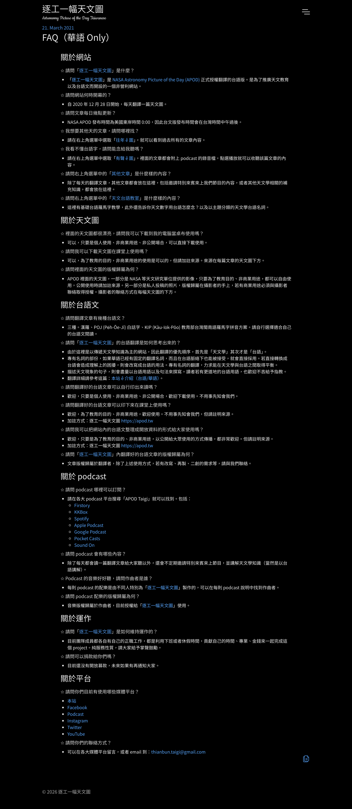

# ApodDataMirror

Data mirror for ChhoeTaigi Apod. This site provides direct access to the Taigi vocabulary of every article of [逐工一幅天文圖 (apod.tw)](https://apod.tw/), the Taigi translation of NASA's Astronomy Picture of the Day: each article ends in a 詞彙學習 (vocabulary) table giving the day's astronomy terms in Han-Lo, Pe̍h-ōe-jī, KPL, Mandarin and English. Every row of every table is here, with an id, its tone-number input forms and a link to the article; each article's title, which the site gives in the same languages, is the article's first row. The files are hosted on GitHub Pages for easy access.

## Chu-liāu Pán-koân

版權聲明

- 資料來源：逐工一幅天文圖 <https://apod.tw>
- 資料授權：[apod.tw FAQ](https://apod.tw/faq/)

```
✩ 請問我可以把網站內的台語文整理成開放資料的形式給大家使用嗎？
歡迎，只要是為了教育的目的、非商業用途，以公開給大眾使用的方式傳播，都非常歡迎。但請註明來源。
加註方式：逐工一幅天文圖 https://apod.tw
```

apod.tw welcomes its Taigi text being compiled into open data for **educational, non-commercial, public** use, **with attribution**. If you redistribute this table or anything built from it, credit `逐工一幅天文圖 https://apod.tw`.

The FAQ page as captured on 2026-10-10, for the record:



## Latest Version

- **Version ID:** `20261020-000554`
- **Last Updated:** 2026-10-20
- **Source:** every daily article listed by `https://apod.tw/sitemap.xml` and the `/daily/` listing, fetched 2026-10-10; articles from 2019-04-11 to 2025-10-04
- **Coverage:** 1,511 articles, every one with a 詞彙學習 table; 15,098 rows, of which 1,511 titles and 13,587 vocabulary entries; 4,943 distinct Pe̍h-ōe-jī forms among the vocabulary entries

You can check [**manifest.json**](./public/manifest.json) for the latest version information programmatically. It records `last_updated`, `latest_version_dir`, the source and the newest article's date, per-file SHA256 hashes, and row counts.

## Accessing Files

The files are organized by version. Once updated, the latest files will be in `public/{version}/`.

```
bunji/                      # 文字
  ApodSului.csv/.json         # one row per article title and per vocabulary entry (詞彙)
ApodDataQuality.md/.json    # counts and findings for this version
```

### `ApodSului` — one row per title and per vocabulary entry

15,098 rows in article order, oldest article first. Each article contributes its title as one row, then one row per row of its 詞彙學習 table, in table order.

* **CSV:** `https://chhoetaigi.github.io/ApodDataMirror/public/{version}/bunji/ApodSului.csv`
* **JSON:** `https://chhoetaigi.github.io/ApodDataMirror/public/{version}/bunji/ApodSului.json`
* **Columns:** `WordId, PojUnicode, PojInput, KipUnicode, KipInput, HanLoTaibunPoj, HoaBun, EngBun, LaigoanMia, LaigoanBangchi`

| Column | Site column | Description | Rows filled |
|--------|-------------|-------------|-------------|
| `WordId` | | The row's id: the article's date and a two-digit number, e.g. `20250613-03`. `00` is the article's title, `01` onward its table rows, numbered as on the page | 15,098 |
| `PojUnicode` | POJ | The entry in Pe̍h-ōe-jī, e.g. `o͘-àm-bu̍t-chit`; in a title row the `[POJ]` heading | 15,090 |
| `PojInput` | | The same in tone-number input form, e.g. `oo-am3-but8-chit` | 15,090 |
| `KipUnicode` | KIP | The entry in KPL, e.g. `oo-àm-bu̍t-tsit`; in a title row the `[KIP]` heading | 15,083 |
| `KipInput` | | The same in tone-number input form, e.g. `oo-am3-but8-tsit` | 15,083 |
| `HanLoTaibunPoj` | 漢羅 | The entry in Han-Lo, e.g. `烏暗物質`, `Hubble 太空望遠鏡`; in a title row the `[漢羅]` heading, e.g. `Rubin ê 星系` | 15,098 |
| `HoaBun` | 華語 | Mandarin, e.g. `暗物質`; empty in every title row, the site has no Mandarin title | 13,582 |
| `EngBun` | English | English, e.g. `dark matter`; in a title row the `[English]` heading, e.g. `Rubin's Galaxy` | 15,088 |
| `LaigoanMia` | | The source, as apod.tw asks to be credited: `逐工一幅天文圖 https://apod.tw` in every row | 15,098 |
| `LaigoanBangchi` | | Link to the article, e.g. `https://apod.tw/daily/20250613/` | 15,098 |

The column names after `WordId` are the ones the ChhoeTaigi database uses, so the table can be loaded without renaming. The same term appears in as many rows as articles that list it: `銀河系` is a row of every article about a galaxy. Rows are not merged, so each keeps the link to the article that taught it.

**Title rows and table rows.** A title row is the one whose `WordId` ends in `-00`; there is exactly one per article, and it comes before the article's table rows. To take only the vocabulary, drop the `-00` rows; to list an article's rows, group on the date in `WordId` or on `LaigoanBangchi`. A title row has no Mandarin, and a few lack a heading on the site (listed in the report under Titles), so its `HoaBun` is always empty and one of its other cells may be.

CSV is UTF-8 **with BOM** (so Excel auto-detects the encoding), every field quoted, with a header row (~3.5 MB). JSON is a UTF-8 array with one record per line (~5.7 MB).

## How the table is built

- **Which articles.** apod.tw is a static site with no API. Its daily articles are enumerated from `sitemap.xml` and, independently, from the paginated `/daily/` listing; the union is fetched, and any difference between the two is listed in the report (none so far). Every article has a URL of the form `https://apod.tw/daily/YYYYMMDD/`.
- **The vocabulary table.** Each article's `詞彙學習` heading is followed by a table with the columns `漢羅`, `POJ`, `KIP`, `華語`, `English`. Cells are matched to the database columns by header name, so a table with the columns in another order would still load; a table with other columns, a row with a different number of cells, or an article with no table is listed in the report (none so far). Cell text is taken as rendered, with whitespace collapsed; nothing is corrected.
- **Titles.** Every article repeats its title in four headings, `[漢羅] …`, `[POJ] …`, `[KIP] …`, `[English] …`; those become the article's title row, placed before its table rows. A heading written with the tag as a link (`English …`) or with no space after the tag is read all the same; a missing or empty heading is an empty cell, listed in the report (7 articles in this version; where the `[漢羅]` heading is missing the page's `<h1>` stands in; an article with no title heading at all and no `<h1>` would get no title row, none so far). The site has no Mandarin title, so `HoaBun` is empty in every title row.
- **`PojInput` / `KipInput`.** Each tone mark is removed and its number appended to the word: acute 2, grave 3, circumflex 5, macron 7, vertical line 8, breve or double acute 9. In the Pe̍h-ōe-jī column `o͘` → `oo` and `ⁿ` → `nn`; KPL writes those as plain letters already, and uses the same tone marks, so the same conversion serves both. Only Latin runs are converted; Han characters, digits and names pass through (`UGC jī-pat-pat-ngó͘` → `UGC ji7-pat-pat-ngoo2`). A word with two tone marks is left as written and listed in the report (none in this version). The conversion is the one the sibling Wikipedia and Wiktionary mirrors use.
- **Ids.** `WordId` is the article's date as its URL writes it and a two-digit number: `00` for the title, then the row's position in the site's table — header excluded, blank rows included — so `20250613-03` is the third row of the table of 2025-06-13 and the `row 3` of the report. An id names a place on a page, not a term: should the site insert or remove a row, the rows below it get new ids in the next version. The number grows to three digits if a table ever has a hundred rows (the largest has 25).
- **`LaigoanMia` / `LaigoanBangchi`.** The source name is the attribution line apod.tw's FAQ asks for, the same in every row; the link is the article URL exactly as the sitemap lists it, with its trailing slash.

## Caveats

### 1. Everything is published as written

The vocabulary was typed by hand over six years, and the report lists what looks wrong rather than correcting it: a Pe̍h-ōe-jī cell that holds KPL spellings (`hok-siā-suànn`), a KPL cell that holds Pe̍h-ōe-jī (`Thian-gô-chō`, `goe̍h-îⁿ`), a Han character inside a reading (`lio̍k-lio̍k柱-lio̍k`), a stray letter (`lji̍t-tsuân-si̍t`), an empty cell. Title rows are checked the same way (a `[KIP]` heading in Pe̍h-ōe-jī, a tone mark on a catalogue letter such as `Ḿ7`). Each such row is in `ApodDataQuality.md` with a link to its article and its place on the page (`title` or `row N`). `PojInput` and `KipInput` are built from the cell as written, so a KPL spelling in the POJ column gives a KPL input form.

### 2. Names, numbers and symbols are readings too

The site writes catalogue numbers and names out in Taigi — `UGC 2885` is `UGC jī-pat-pat-ngó͘`, `Hubble 太空望遠鏡` is `Hubble Thài-khong-bōng-oán-kiàⁿ` — and sometimes leaves them as is (`M94: Siang-khoân-seng-hē`). The Latin names stay in `PojUnicode` and `KipUnicode`; a search by Pe̍h-ōe-jī finds the Taigi part.

### 3. The Han-Lo column follows the translator

The Roman parts of `HanLoTaibunPoj` are whatever the translator wrote: mostly orthography-neutral words (`ê`, `kah`) and names, occasionally a Pe̍h-ōe-jī loanword (`電子 bó͘-lu-to͘h`) or a KPL one (`goo-lú-huh`). It is published under `HanLoTaibunPoj` because it is the site's one Han-Lo column; there is no separate `HanLoTaibunKip`.

### 4. The site's own vocabulary page is not the source

apod.tw also publishes [天文台語詞彙對照表](https://apod.tw/vocabulary/), a merged list of the same tables. It is a snapshot (dated 2024-09-17 at the time of writing) and merges entries; this mirror reads the tables in the articles themselves, which are current and keep each entry's link.

## Updating

```bash
cd script && python update_data.py
```

Fetches the sitemap, the listing pages and every article (about 1,500 pages, a few minutes with four polite connections), builds the table, and publishes a new version directory only when it changed. Pure Python 3 standard library.

## Source

Original data source: <https://apod.tw/> — 逐工一幅天文圖, Taigi translations of [Astronomy Picture of the Day](https://apod.nasa.gov/).
